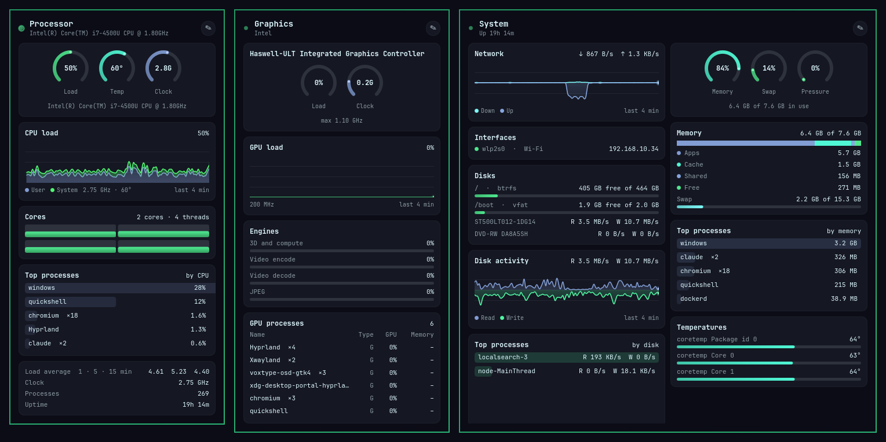

# OmaSee

A system monitor for the [Omarchy](https://omarchy.org) bar. It shows CPU, GPU, network and
memory, with animated reports that open from the bar.




<sub>Screenshots are from an older laptop (Intel i7-4500U with Haswell graphics), so the
GPU reads 0%: that chip doesn't report usage to Linux.</sub>

## Install

```bash
omarchy plugin add https://github.com/toyCaller/omasee.git --enable
```

It needs Python 3.11 or newer, with no extra packages. To update it later, run
`omarchy plugin update oladi.omasee`. To remove it, run `omarchy plugin remove oladi.omasee`.

## Animations

- **Heartbeat dots:** each bar section has a dot that pulses with every sample and breathes
  in and out. The higher the load, the faster it breathes. The dot is green under 60%,
  yellow from 60% and red from 85%. When the engine stops sending data, the dots turn grey
  and the section dims.
- **Sparklines:** a faint graph of about the last 90 seconds runs under each section's text.
- **Report entrance:** cards fade and rise into place one after another, with a small
  overshoot.
- **Live graphs:** lines are smoothed and fills fade to transparent. The graph glides one
  step left on each sample instead of jumping. The newest point has a small breathing
  marker.
- **Dials:** gauges sweep to each new reading. Readings at 85% or higher get a breathing
  halo.
- **Meters, core bars and process bars:** these slide to new values. Meters at 85% or higher
  slowly pulse.
- **Fans:** each fan icon spins in proportion to its RPM.

All of it can be switched off (see the settings below).

## Using it

Rest the pointer on CPU, GPU or the network section, or click it, to open its report. Move
along the bar to switch reports, and move away to close. The System report also closes if
you cross it without stopping.

Click the ✎ button in a report to rearrange it:

| Control | What it does |
|---|---|
| `CPU load ›` | Changes which sensor the card shows |
| `S` / `M` / `L` | Changes the card size |
| `↑` `↓` `←` `→` | Moves the card, including into a new column (up to three) |
| `✕` | Removes the card |
| **+ Add card** | Adds one of 13 card types |
| **Reset** / **Done** | Restores the defaults, or saves the layout |

You can also control it from scripts and keybindings:

```bash
omarchy-shell omasee open cpu      # or gpu, system
omarchy-shell omasee toggle gpu
omarchy-shell omasee edit
omarchy-shell omasee close
```

## Settings

To show temperatures in Fahrenheit:

```bash
omarchy bar set oladi.omasee temperatureUnit Fahrenheit
```

For everything else, create `~/.config/omasee/config.json`. Any setting you leave out keeps
its default.

```json
{
  "openDelayMs": 280,
  "systemOpenDelayMs": 480,
  "closeDelayMs": 300,
  "closeOnPassThrough": true,
  "passThroughMs": 400,
  "animations": true,
  "sparklines": true,
  "heartbeat": true
}
```

To work on the UI with fake data, run `omarchy bar set oladi.omasee demo true --json`.
Set it back to `false` when you're done.

## Security

The engine is written in Python using only the standard library, and it never needs root.

- **No subprocesses.** The engine doesn't start any other programs. It looks up PCI names in
  `pci.ids` instead of running `lspci`, and Python runs in isolated mode (`-I`), so nothing
  from your environment or working directory can be injected into it.
- **Private socket.** The socket lives in `$XDG_RUNTIME_DIR` and has permissions 0600. The
  engine refuses to start if that directory isn't private to you. It checks the user ID of
  every client that connects (`SO_PEERCRED`) and rejects other users.
- **Lock file.** The lock file is opened with `O_NOFOLLOW`, so a symlink planted in its place
  can't redirect it. A stale socket is only deleted if it really is a socket owned by you.
- **Limits on clients.** At most 16 clients can connect. Commands come from a fixed list of
  three. Lines are limited to 256 bytes. A client that stops reading is disconnected rather
  than letting its unsent data grow in memory.
- **Process names only.** It never reads process command lines, which can contain tokens.
  Names come from the executable or `comm` field, with control characters removed and a
  64-character limit.
- **No shell.** The UI saves layouts by running `omarchy bar set` with an argument list,
  never a shell string. Card files are loaded from a fixed list of names. Saved layouts,
  `config.json` and theme colours are checked and size-limited when they're read.

## What it touches

- **Runs** the engine, which one copy serves every monitor. While a report is open it also
  runs `hyprctl cursorpos` every 80 ms.
- **Reads** `/proc`, `/sys`, your own processes' DRM fdinfo, NVIDIA's NVML library if it's
  present, and its config file.
- **Writes** `omasee.sock` and `omasee.sock.lock` in `$XDG_RUNTIME_DIR`, and your layouts to
  `shell.json`.

## Development

```bash
python3 -I tests/test_engine.py           # parser, security and socket tests
engine/omasee-engine --once               # print one full live sample
engine/omasee-engine --once --demo        # print one full demo sample
```

`docs/FEATURES.md` lists every feature of omaview, which OmaSee was rebuilt from. That's where
to check that nothing was lost.

## Licence

MIT. OmaSee is a clean rewrite modelled on the features of
[omaview](https://github.com/qnlbnsl/omaview) by qnlbnsl (MIT).
